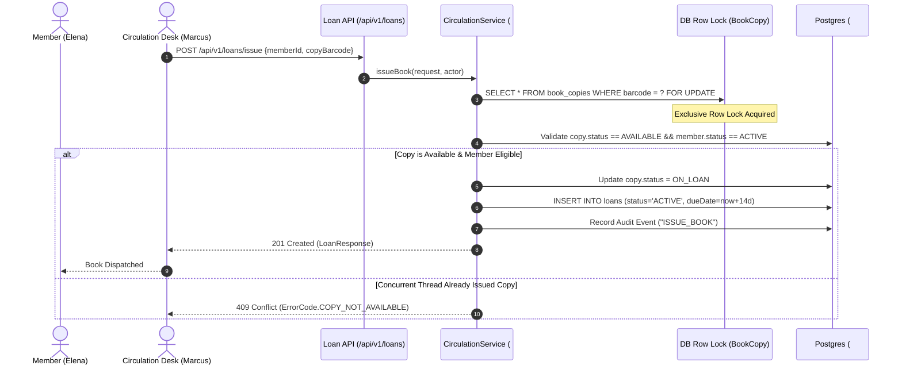
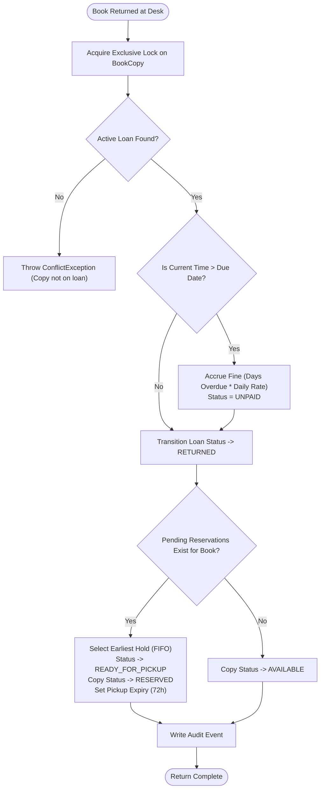

# Product Requirements Document (PRD)
## Infinity Library Management System — Enterprise Backend Platform
**Document Identifier:** `PRD-ILMS-2026`  
**Target Release:** Version 1.0.0 (Production General Availability)  
**Author:** Staff Software Engineer & Product Architecture Lead  
**Design Palette:** Teal (`#2A5344`), Deep Navy (`#0B3048`), Neon Lime (`#B9F12F`), Warm Off White (`#F2F0E9`)

---

> **Related Engineering Documents:**  
> [Root README](README.md) &bull; [SRS Specification](SRS.md) &bull; [Product Requirements (PRD)](PRD.md) &bull; [Project Report](PROJECT_REPORT.md) &bull; [Security Review](SECURITY_REVIEW.md) &bull; [QA Report](QA_REPORT.md) &bull; [Website UX Audit](WEBSITE_AUDIT_REPORT.md) &bull; [Documentation Index](docs/README.md)

---

## 1. Executive Summary & Product Vision

### 1.1 Product Vision
The **Infinity Library Management System (ILMS)** is a high-performance, developer-first backend system designed to modernize library circulation, inventory control, and member services. While traditional library software often relies on monolithic desktop installations prone to concurrency conflicts and inventory desynchronization, ILMS delivers a resilient, cloud-native **modular monolith** built on **Java 25 LTS** and **Spring Boot 4.2.x**. 

Our vision is to provide municipal, academic, and research libraries with an uncompromised transactional platform guaranteeing that every physical item, loan, fine, and reservation is mathematically verified, auditable, and impervious to double-booking race conditions.

### 1.2 Core Value Proposition
- **Absolute Inventory Truth:** Distinction between bibliographic metadata (`Book`) and physical inventory copies (`BookCopy`), with availability dynamically derived rather than maintained via fragile counters.
- **Guaranteed Concurrency Safety:** Exclusive pessimistic locking (`SELECT ... FOR UPDATE`) guarantees zero double-checkouts under peak concurrent circulation.
- **Zero Financial Ambiguity:** Real-time fine calculation with immutable ledger transactions for payments and audited waiver approvals.
- **Enterprise-Grade Identity Protection:** Password hashing powered by Argon2id, paired with rotating JWT tokens and automatic revocation upon token replay detection.

---

## 2. Problem Statement & Market Opportunity

### 2.1 The Legacy Library Problem
Existing open-source and legacy proprietary Integrated Library Systems (ILS) suffer from key engineering deficiencies:
1. **Concurrency Failures:** When multiple circulation desks or online members request the same high-demand title simultaneously, optimistic checks often allow multiple patrons to check out the same physical barcode.
2. **Inventory Drift:** Counter-based systems (`available_copies = available_copies - 1`) experience data drift over time due to unhandled exceptions, uncommitted transactions, or uncataloged loss.
3. **Security Vulnerabilities:** Broken Object-Level Authorization (BOLA/IDOR) frequently permits members to manipulate sequential query parameters (`/api/members/123/loans`) to view other patrons' private reading habits and fines.
4. **Poor Auditability:** Financial adjustments and waived fines lack cryptographic or immutable database tracking, leaving institutions vulnerable to internal discrepancies.

### 2.2 The Infinity Solution
ILMS resolves these systemic issues through rigorous software engineering:
- Exclusive row-level locking ensures only one patron succeeds during simultaneous checkout requests.
- True physical copy modeling computes inventory status directly from active copy records.
- Spring Security method-level authorization inspects authenticated principal ownership before servicing member subresources.
- Strict audit trails capture every administrative action, book addition, status alteration, and fee waiver.

---

## 3. User Personas & User Journeys

### 3.1 Persona Profiles

#### Persona 1: Clara Vance — Senior Systems Librarian
- **Context:** Oversees collection development, catalog classification, and operational policies for a university library with 100,000+ volumes.
- **Pain Points:** Needs certainty that new acquisitions are correctly serialized and that catalog searches are sub-50ms even during semester rush.
- **Key Goals:** Fast batch registration of book copies, real-time aggregate inventory views, and policy configuration for loan periods and fine thresholds.

#### Persona 2: Marcus Chen — Circulation Desk Specialist
- **Context:** Manages patron counter checkouts, physical returns, and overdue fine collection.
- **Pain Points:** Legacy system freezes during peak class breaks; returns with pending reservations often fail to notify staff or lock the book.
- **Key Goals:** Instant barcode scanning, atomic loan issuance, transparent fine waiver logging with mandatory reasons, and zero double-issue errors.

#### Persona 3: Elena Rostova — Graduate Research Member
- **Context:** Active borrower managing research loans across multiple departments.
- **Pain Points:** Frustration when books marked "Available" in the OPAC are already taken; lack of clear visibility into hold queue position.
- **Key Goals:** Reliable book reservation holds, clear visibility into due dates, transparent fine breakdowns, and total privacy regarding borrowing history.

---

### 3.2 Key User Journeys

#### Journey A: High-Concurrency Book Issuance


#### Journey B: Book Return with FIFO Reservation Cascading


---

## 4. Product Features & MVP Scope

| Feature Area | MVP Scope (v1.0.0 General Availability) | Post-MVP Roadmap (v1.1 - v2.0) |
| :--- | :--- | :--- |
| **Authentication & IAM** | Argon2id hashing, short-lived JWTs, rotating refresh tokens with reuse revocation, RBAC (`ADMIN`, `LIBRARIAN`, `MEMBER`). | OAuth2/OIDC integration (Google Workspace, Okta), passkeys/WebAuthn support. |
| **Catalog & Inventory** | Bibliographic title entity (`Book`) separate from physical inventory (`BookCopy`), dynamic inventory metrics, paginated search. | Multi-volume sets, digital eBook loans, cover image CDN hosting. |
| **Circulation** | Pessimistic locking on issue, idempotent checkout/return requests, timezone-aware overdue duration calculations. | Self-checkout RFID kiosk protocol (SIP2/NCIP), automated SMS/email return reminders. |
| **Reservations** | FIFO queue allocation, duplicate hold prevention, automatic hold allocation on return, hold expiration scheduler. | Member-specified pickup branch selection, queue prioritization for faculty. |
| **Fines & Accounting** | Deterministic accrual, partial/full payments, audited waivers with mandatory justification, immutable audit ledger. | Stripe / PayPal payment gateway integration, automated monthly billing exports. |
| **Observability & Analytics** | Real-time aggregate reports, Spring Boot Actuator health and metrics, structured audit trail. | Prometheus/Grafana pre-built dashboards, predictive collection purchasing analytics. |

---

## 5. Security & Privacy Requirements

### 5.1 Defense-in-Depth Model
1. **Broken Object-Level Authorization (BOLA) Prevention:**
   Members querying `/api/v1/members/{id}/loans` are evaluated against `SecurityContextHolder`:
   ```java
   @PreAuthorize("hasAnyRole('LIBRARIAN', 'ADMIN') or (hasRole('MEMBER') and #id == authentication.principal.memberId)")
   ```
2. **Cryptographic Token Safety:**
   Refresh tokens are 256-bit secure random strings stored as unique hashes. Any detected token reuse revokes the entire token family, neutralizing stolen token attacks immediately.
3. **Audit Trail Immutability:**
   Every administrative action records actor identity, IP address, timestamp, entity type, and delta change to the `audit_events` database table.

---

## 6. Key Performance Indicators (KPIs) & Success Metrics

| Metric | Target Goal | Measurement Method |
| :--- | :--- | :--- |
| **Concurrency Double-Booking Rate** | **0.00%** (Zero Tolerance) | Automated multithreaded test suite (`ConcurrencyIssuingIntegrationTest`) |
| **API Latency ($P_{95}$)** | **< 100 ms** for non-locking endpoints | Spring Boot Actuator `/actuator/metrics/http.server.requests` |
| **Checkout Transaction Duration** | **< 200 ms** under peak load | Database connection duration metrics |
| **Test Coverage** | **> 80%** core business logic | JaCoCo verification report during GitHub Actions CI build |
| **Automated Build Reliability** | **100%** green builds on `main` | GitHub Actions workflow execution history |
| **Inventory Desynchronization** | **0 discrepancies** | Real-time derived count queries vs raw physical copy counts |

---

## 7. Release Plan & Acceptance Criteria

### 7.1 Release Milestones
- **Milestone 1 (Core Domain & Migrations):** Schema v1/v2 Flyway migrations, JPA entities, database relationships, and repository interfaces. *(Completed)*
- **Milestone 2 (Circulation & Concurrency Engine):** Pessimistic locking implementation, return flow with FIFO reservation auto-allocation, and idempotent request handling. *(Completed)*
- **Milestone 3 (Security & Financial Auditing):** Argon2id hashing, JWT token rotation, BOLA defenses, and fine payment/waiver workflows. *(Completed)*
- **Milestone 4 (Verification & Packaging):** Full unit, service, concurrency, integration, and architecture test suite (47/47 passing), Docker multi-stage containerization, Docker Compose environment, and GitHub Actions CI pipeline. *(Completed)*

### 7.2 General Availability (GA) Acceptance Criteria
1. All 47 automated tests execute with zero failures in both local and CI environments.
2. Architecture rules enforced by ArchUnit pass with 0 rule violations.
3. Docker image builds successfully and passes Actuator container health checks within 45 seconds.
4. Complete OpenAPI 3.0 specification served at `/api/docs` and customized Swagger UI at `/swagger-ui.html`.
5. Four mandatory project documents (`SRS.md`, `PRD.md`, `PROJECT_REPORT.md`, `README.md`) finalized and placed in the project root.
