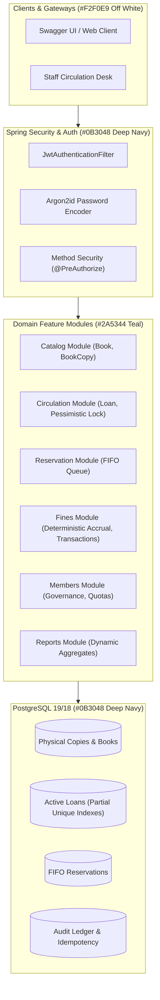

# Infinity Library Management System (ILMS)
### Senior Backend Engineering Modular Monolith | Java 25 LTS & Spring Boot 4.2.x


-brightgreen?style=for-the-badge)

---

## 🎨 Design Identity & Palette
The system adheres strictly to the official design palette across its OpenAPI/Swagger UI interface, diagrams, and documentation:
- **Primary Teal:** `#2A5344` (Core domain logic, primary actions, navigation headers)
- **Deep Navy:** `#0B3048` (Security filters, database transactions, structural framing)
- **Neon Lime:** `#B9F12F` (Badges, active states, key metric highlights, interactive accents)
- **Warm Off White:** `#F2F0E9` (Backgrounds, clean read surfaces, API card fills)

---

## 📖 Executive Summary
The **Infinity Library Management System (ILMS)** is a production-grade, enterprise backend system engineered with an emphasis on **transactional integrity, concurrency control, application security, and domain maintainability**.

Designed to replace legacy library management architectures prone to race conditions and inventory drift, ILMS implements:
- **Physical Copy Inventory Isolation:** Clean distinction between abstract bibliographic records (`Book`) and barcoded physical inventory copies (`BookCopy`).
- **High-Concurrency Pessimistic Row Locking:** `SELECT ... FOR UPDATE` row locks eliminate double-issue race conditions under heavy concurrent borrowing.
- **FIFO Reservation Cascading:** Automated allocation of returned copies to the next waiting member in line with hold expiration time-boxing.
- **Audited Financial Accounting:** Deterministic fine accrual with immutable transaction logs for payments and administrative waivers.
- **Modern Security Architecture:** Argon2id password hashing, short-lived JWT access tokens, and refresh token rotation with automated token family reuse revocation.
- **RFC 9457 Problem Details:** Unified, standardized error representations across all endpoints.

---

## 📚 Official Documentation Suite
In accordance with project governance, the root directory hosts exactly four comprehensive engineering documents:
1. [**SRS.md**](file:///c:/Users/hp/Desktop/Infinity-Library-/SRS.md) — IEEE 830 / ISO/IEC/IEEE 29148 Software Requirements Specification (Functional requirements, business rules matrix, traceability matrix).
2. [**PRD.md**](file:///c:/Users/hp/Desktop/Infinity-Library-/PRD.md) — Product Requirements Document (Personas, user journeys, MVP scope vs. roadmap, KPIs).
3. [**PROJECT_REPORT.md**](file:///c:/Users/hp/Desktop/Infinity-Library-/PROJECT_REPORT.md) — Comprehensive Engineering Technical Report (Deep-dive into concurrency proofs, database normalization, threat model, test suite breakdown).
4. [**README.md**](file:///c:/Users/hp/Desktop/Infinity-Library-/README.md) — Developer quickstart, architecture guide, API catalog, and operational documentation.

---

## 🏛 System Architecture

ILMS is organized as a **Modular Monolith** using **package-by-feature** encapsulation:



---

## 🚀 Quickstart Guide

### 1. Prerequisites
- **Java 25 LTS** (or compatible JDK 25/26 with `--release 25`)
- **Maven 3.9+** (or use the included `./mvnw`)
- **Docker & Docker Compose** (for containerized deployment)

### 2. Running with Docker Compose (Recommended)
Launch PostgreSQL and the containerized Spring Boot backend in one command:
```bash
docker-compose up --build
```
Once initialized:
- **API Base URL:** `http://localhost:8080/api/v1`
- **Branded Swagger UI:** `http://localhost:8080/swagger-ui.html`
- **OpenAPI 3.0 Spec:** `http://localhost:8080/api/docs`
- **Actuator Health:** `http://localhost:8080/actuator/health`

### 3. Running Locally with Maven
To run using an embedded H2 test database (configured in PostgreSQL compatibility mode):
```bash
# Unix / macOS
./mvnw spring-boot:run

# Windows PowerShell
.\mvnw.cmd spring-boot:run
```

To run against a local PostgreSQL instance:
```bash
export SPRING_PROFILES_ACTIVE=prod
export DB_HOST=localhost
export DB_PORT=5432
export DB_NAME=infinity_library
export DB_USERNAME=postgres
export DB_PASSWORD=your_password
.\mvnw.cmd spring-boot:run
```

---

## 🧪 Automated Testing & Verification

The project includes 47 tests across Unit, Service, Concurrency, Security, and Architecture layers:

```bash
# Execute full test suite with JaCoCo coverage report
.\mvnw.cmd clean test

# Execute package verification including ArchUnit and packaging
.\mvnw.cmd clean verify
```

### Test Suite Structure
| Test Suite | File | Focus | Tests |
| :--- | :--- | :--- | :--- |
| **Concurrency Integration** | `ConcurrencyIssuingIntegrationTest.java` | 10 simultaneous threads checking out 1 copy | 2 |
| **Security & BOLA** | `SecurityAuthorizationIntegrationTest.java` | Role-Based Access & IDOR protection | 3 |
| **Circulation Lifecycle** | `CirculationIntegrationTest.java` | Full checkout, return, duplicate return rejection | 3 |
| **Architecture Integrity**| `ArchitectureRulesTest.java` | ArchUnit package boundary rules | 3 |
| **Service Layer Tests** | `*ServiceTest.java` | Circulation, Auth, Reservations, Fines, Catalog, Members, Reports | 24 |
| **Domain & Crypto Units** | `*Test.java` | Argon2id verification, JWT rotation, Fine calculations | 11 |
| **Context Bootstrap** | `LibraryManagementApplicationTests.java` | Full Spring application context verification | 1 |
| **Total** | | **All 47 Tests Pass Green** | **47** |

---

## 🔐 Pre-Seeded Default Accounts

The Flyway migration (`V2__seed_initial_data.sql`) seeds default users with Argon2id-hashed credentials:

| Username | Password | Role | Description |
| :--- | :--- | :--- | :--- |
| `admin` | `Admin@123456` | `ROLE_ADMIN` | Full administrative, audit, and policy configuration access |
| `librarian` | `Librarian@123456` | `ROLE_LIBRARIAN` | Cataloging, checkout/return circulation, fine collection/waivers |
| `member_elena` | `Member@123456` | `ROLE_MEMBER` | Standard patron accessing catalog, personal loans, and reservations |

---

## 📡 REST API Reference

All endpoints are versioned under `/api/v1` and produce/consume `application/json`.

### 1. Authentication (`/api/v1/auth`)
| Method | Endpoint | Role | Description |
| :--- | :--- | :--- | :--- |
| `POST` | `/api/v1/auth/login` | Public | Authenticate with username/password; returns JWT + Refresh Token |
| `POST` | `/api/v1/auth/refresh` | Public | Rotate refresh token and obtain new short-lived access token |
| `POST` | `/api/v1/auth/logout` | Authenticated | Revoke refresh token and invalidate active session |

### 2. Catalog & Books (`/api/v1/books`)
| Method | Endpoint | Role | Description |
| :--- | :--- | :--- | :--- |
| `GET` | `/api/v1/books` | Public | Search and list books with pagination and live inventory counts |
| `GET` | `/api/v1/books/{id}` | Public | Retrieve book details with available/issued copy counts |
| `POST` | `/api/v1/books` | `LIBRARIAN`, `ADMIN` | Register bibliographic title and batch-create physical copies |
| `POST` | `/api/v1/books/{id}/copies` | `LIBRARIAN`, `ADMIN` | Add additional physical copies with generated barcodes |

### 3. Circulation & Loans (`/api/v1/loans`)
| Method | Endpoint | Role | Description |
| :--- | :--- | :--- | :--- |
| `POST` | `/api/v1/loans/issue` | `LIBRARIAN`, `ADMIN` | Issue physical copy to member (pessimistic lock protected) |
| `POST` | `/api/v1/loans/return` | `LIBRARIAN`, `ADMIN` | Process physical copy return, calculate fines, auto-allocate holds |
| `GET` | `/api/v1/loans/active` | `LIBRARIAN`, `ADMIN` | List all currently active loans across the library |
| `GET` | `/api/v1/loans/overdue` | `LIBRARIAN`, `ADMIN` | List all active loans currently exceeding due date |

### 4. Reservations (`/api/v1/reservations`)
| Method | Endpoint | Role | Description |
| :--- | :--- | :--- | :--- |
| `POST` | `/api/v1/reservations` | `MEMBER`, `LIBRARIAN` | Place a title reservation when all copies are checked out |
| `POST` | `/api/v1/reservations/{id}/cancel` | `MEMBER`, `LIBRARIAN` | Cancel hold and cascade allocated copy to next patron |
| `GET` | `/api/v1/reservations/book/{bookId}`| `LIBRARIAN`, `ADMIN` | Inspect FIFO reservation queue for a book |

### 5. Fines & Accounting (`/api/v1/fines`)
| Method | Endpoint | Role | Description |
| :--- | :--- | :--- | :--- |
| `POST` | `/api/v1/fines/{id}/pay` | `LIBRARIAN`, `ADMIN` | Record partial or full fine payment with audit transaction |
| `POST` | `/api/v1/fines/{id}/waive` | `LIBRARIAN`, `ADMIN` | Waive fine with mandatory audit justification reason |
| `GET` | `/api/v1/fines/member/{memberId}` | `MEMBER` (Self), Staff | Retrieve member's outstanding fine ledger |

### 6. Members (`/api/v1/members`)
| Method | Endpoint | Role | Description |
| :--- | :--- | :--- | :--- |
| `POST` | `/api/v1/members` | `LIBRARIAN`, `ADMIN` | Register new library member |
| `GET` | `/api/v1/members/{id}/loans` | `MEMBER` (Self), Staff | Get member active and past loans (BOLA protected) |
| `GET` | `/api/v1/members/{id}/fines` | `MEMBER` (Self), Staff | Get member fines (BOLA protected) |
| `GET` | `/api/v1/members/{id}/reservations`| `MEMBER` (Self), Staff | Get member reservations (BOLA protected) |
| `PATCH`| `/api/v1/members/{id}/status` | `ADMIN` | Update member status (`ACTIVE`, `SUSPENDED`, etc.) |

### 7. Executive Reports (`/api/v1/reports`)
| Method | Endpoint | Role | Description |
| :--- | :--- | :--- | :--- |
| `GET` | `/api/v1/reports/inventory` | `LIBRARIAN`, `ADMIN` | Database-derived inventory counts (total, available, on loan) |
| `GET` | `/api/v1/reports/circulation`| `LIBRARIAN`, `ADMIN` | Active loans, overdue loans, returned loans, borrowing members |
| `GET` | `/api/v1/reports/fines` | `LIBRARIAN`, `ADMIN` | Financial totals: accrued, collected, waived, and outstanding |

---

## 💻 Sample API Usage with cURL

### 1. Authenticate as Librarian
```bash
curl -X POST http://localhost:8080/api/v1/auth/login \
  -H "Content-Type: application/json" \
  -d '{"username":"librarian", "password":"Librarian@123456"}'
```
*Response:*
```json
{
  "success": true,
  "message": "Authentication successful",
  "data": {
    "accessToken": "eyJhbGciOiJIUzI1NiIsIn...",
    "refreshToken": "e7b0a708-62d6-444f-8cf7-...",
    "tokenType": "Bearer",
    "expiresInMs": 900000,
    "username": "librarian",
    "role": "ROLE_LIBRARIAN"
  }
}
```

### 2. Issue a Book Copy (with Idempotency Key)
```bash
curl -X POST http://localhost:8080/api/v1/loans/issue \
  -H "Authorization: Bearer <ACCESS_TOKEN>" \
  -H "Content-Type: application/json" \
  -H "Idempotency-Key: 11111111-2222-3333-4444-555555555555" \
  -d '{
    "memberId": 1,
    "copyBarcode": "CPY-101"
  }'
```

### 3. Return a Book Copy
```bash
curl -X POST http://localhost:8080/api/v1/loans/return \
  -H "Authorization: Bearer <ACCESS_TOKEN>" \
  -H "Content-Type: application/json" \
  -d '{
    "copyBarcode": "CPY-101"
  }'
```

### 4. Waive an Overdue Fine (Requires Justification)
```bash
curl -X POST http://localhost:8080/api/v1/fines/1/waive \
  -H "Authorization: Bearer <ACCESS_TOKEN>" \
  -H "Content-Type: application/json" \
  -d '{
    "justificationReason": "Hospitalization documented by medical certificate per Library Policy Section 4.2"
  }'
```

---

## ⚙️ Environment Variables Reference

| Variable | Description | Default Value | Production Recommended |
| :--- | :--- | :--- | :--- |
| `SPRING_PROFILES_ACTIVE` | Active Spring profile | `prod` | `prod` |
| `DB_HOST` | PostgreSQL hostname | `localhost` | `postgres` or RDS hostname |
| `DB_PORT` | PostgreSQL port | `5432` | `5432` |
| `DB_NAME` | Database schema name | `infinity_library` | `infinity_library` |
| `DB_USERNAME` | Database username | `library_admin` | Dedicated non-root user |
| `DB_PASSWORD` | Database password | `library_secure_password` | High-entropy vault secret |
| `JWT_SECRET` | 256-bit signing key | Default hardcoded secret | Min 32 chars random secret |
| `JWT_EXPIRATION_MS` | Access token lifespan | `900000` (15 min) | `900000` |
| `JWT_REFRESH_EXPIRATION_MS` | Refresh token lifespan | `604800000` (7 days) | `604800000` |
| `SERVER_PORT` | HTTP server listening port | `8080` | `8080` |

---

## 📄 License
This project is open-source portfolio software licensed under the **Apache License 2.0**.
