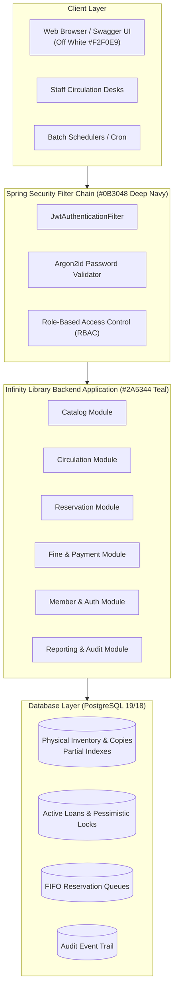

# Software Requirements Specification (SRS)
## Infinity Library Management System — Production Backend Monolith
**Document Identifier:** `SRS-ILMS-2026-V1`  
**Standard:** IEEE 830 / ISO/IEC/IEEE 29148 Compliant  
**Version:** 1.0.0  
**Status:** Approved for Production  
**Design Palette:** Teal (`#2A5344`), Deep Navy (`#0B3048`), Neon Lime (`#B9F12F`), Warm Off White (`#F2F0E9`)

---

> **Related Engineering Documents:**  
> [Root README](README.md) &bull; [SRS Specification](SRS.md) &bull; [Product Requirements (PRD)](PRD.md) &bull; [Project Report](PROJECT_REPORT.md) &bull; [Security Review](SECURITY_REVIEW.md) &bull; [QA Report](QA_REPORT.md) &bull; [Website UX Audit](WEBSITE_AUDIT_REPORT.md) &bull; [Documentation Index](docs/README.md)

---

## 1. Introduction

### 1.1 Purpose
This Software Requirements Specification (SRS) document details the functional, non-functional, interface, security, and architectural requirements for the **Infinity Library Management System (ILMS)** backend. ILMS is an enterprise-grade, high-concurrency modular monolith engineered in **Java 25 LTS** and **Spring Boot 4.2.x**, backed by **PostgreSQL 19/18** and **Flyway**. It is designed specifically as a robust backend engineering showcase demonstrating strict ACID compliance, race-condition mitigation via pessimistic database locking, Argon2id cryptographic identity management, and RFC 9457 compliant error handling.

### 1.2 Scope of the System
The Infinity Library Management System automates and guarantees transactional consistency across seven core business domains:
1. **Bibliographic Catalog & Inventory Tracking:** Separation of abstract bibliographic titles (`Book`) from barcode-tagged physical items (`BookCopy`).
2. **Member Lifecycle Management:** Registration, membership tier validation, status governance (`ACTIVE`, `SUSPENDED`, `EXPIRED`), and loan quota enforcement.
3. **High-Concurrency Circulation:** Concurrency-safe loan issuing with pessimistic write locking (`SELECT ... FOR UPDATE`), atomic state transitions, return processing, and idempotency guarantees.
4. **FIFO Reservation Engine:** Queue-ordered hold placements with automatic allocation upon book return and time-boxed hold expirations.
5. **Fine Calculation & Financial Transactions:** Deterministic overdue accruals, idempotent payments, and audited waiver authorizations.
6. **Executive Analytics & Reporting:** Live, aggregate database-derived metrics eliminating stale counter anomalies.
7. **Security, Authentication & Authorization:** Multi-role RBAC (`ADMIN`, `LIBRARIAN`, `MEMBER`), short-lived JWT access tokens, refresh token rotation with family reuse revocation, and BOLA/IDOR protection.

### 1.3 Definitions, Acronyms, and Abbreviations
| Term | Definition |
| :--- | :--- |
| **ACID** | Atomicity, Consistency, Isolation, Durability — database transaction guarantees. |
| **BOLA / IDOR** | Broken Object-Level Authorization / Insecure Direct Object Reference vulnerability. |
| **ISBN** | International Standard Book Number (10 or 13 digits). |
| **JWT** | JSON Web Token (RFC 7519) standard for digitally signed claims. |
| **Argon2id** | Memory-hard password hashing algorithm winner of the Password Hashing Competition. |
| **Pessimistic Locking** | Database-level row locking (`SELECT ... FOR UPDATE`) preventing concurrent checkout of the identical physical item. |
| **RFC 9457** | IETF standard for Problem Details for HTTP APIs (replacing RFC 7807). |
| **Flyway** | Version-controlled, reproducible SQL database migration framework. |
| **Idempotency Key** | A unique client-generated UUID header preventing double-execution of non-idempotent operations. |

---

## 2. Overall Description

### 2.1 System Context Diagram
The ILMS backend acts as the authoritative transactional core servicing web clients, mobile applications, and automated batch systems:

### 2.2 User Personas & Responsibilities
1. **Librarian (`LIBRARIAN`):**
   - Registers new bibliographic titles and adds physical barcode copies.
   - Issues loans to verified members and processes physical returns.
   - Collects fine payments and authorizes overdue waivers with justification.
   - Inspects operational inventory reports.
2. **Administrator (`ADMIN`):**
   - Configures library operational parameters (loan period, daily fine rate, hold expiry).
   - Manages user accounts and adjusts member statuses (`ACTIVE`, `SUSPENDED`).
   - Audits system-wide event logs and financial reconciliations.
3. **Library Member (`MEMBER`):**
   - Discovers bibliographic titles and inspects copy availability.
   - Places reservations on unavailable books.
   - Views personal active loans, hold positions, and outstanding fine balances.
   - Prohibited from accessing other members' financial or loan records (anti-BOLA).

---

## 3. Specific Functional Requirements

### 3.1 Catalog & Physical Copy Management
- **FR-CAT-001 (Bibliographic Registration):** The system shall allow librarians to register bibliographic records including Title, ISBN (10 or 13 digits), Author, Publisher, Publication Year, Genre, Language, and Description. ISBN uniqueness shall be strictly enforced across active records.
- **FR-CAT-002 (Inventory Batch Creation):** Upon registering a title, the system shall instantiate `initialCopies` physical inventory records (`BookCopy`) assigned to the default library facility.
- **FR-CAT-003 (Unique Physical Barcode):** Every physical copy shall possess a unique accession barcode (e.g., `CPY-<bookId>-<UUID>`).
- **FR-CAT-004 (Copy Status Lifecycle):** Each physical copy shall transition strictly through valid states: `AVAILABLE`, `ON_LOAN`, `RESERVED`, `LOST`, `UNDER_MAINTENANCE`, `WITHDRAWN`.
- **FR-CAT-005 (Derived Inventory Calculation):** The system shall compute total, available, and issued counts dynamically via aggregate database queries. Persisted manual counter columns are strictly prohibited.
- **FR-CAT-006 (Search & Paginated Catalog):** The system shall expose paginated searching filtered by Title, Author, or Genre with case-insensitive matching.

### 3.2 Member Management
- **FR-MEM-001 (Member Registration):** The system shall permit registration of library members with full name, email, phone number, and address. Unique membership numbers shall be generated automatically (`LIB-MEM-<UUID>`).
- **FR-MEM-002 (Status Governance):** Members shall possess a status: `ACTIVE`, `SUSPENDED`, `EXPIRED`, `INACTIVE`. Members with unpaid fines exceeding policy thresholds or overdue items shall have their borrowing privileges automatically blocked.
- **FR-MEM-003 (Borrowing Quota Enforcement):** The system shall verify that a member does not exceed the library's maximum active loan limit (default: 5 concurrent loans) prior to issuing an item.
- **FR-MEM-004 (Member Activity Aggregation):** The system shall provide endpoints for inspecting a member's complete loan history, active reservations, and fine balances.

### 3.3 Circulation Management & Concurrency
- **FR-CIR-001 (Pessimistic Locking on Checkout):** When an issue request is initiated, the system shall acquire an exclusive row-level lock (`PESSIMISTIC_WRITE` / `SELECT ... FOR UPDATE`) on the target `BookCopy` within an active transaction.
- **FR-CIR-002 (Eligibility Validation):** The system shall ensure:
  - Copy status is `AVAILABLE` (or `RESERVED` for the specific claiming member).
  - Member status is `ACTIVE`.
  - Member active loan count < max loan limit.
  - Member has no overdue books and no outstanding fines exceeding threshold ($10.00).
- **FR-CIR-003 (Atomic Loan Creation):** The system shall create an `ACTIVE` loan record capturing a point-in-time policy snapshot (`loanPeriodDays`, `dailyFineRate`) and update copy status to `ON_LOAN` within the same transaction.
- **FR-CIR-004 (Return Processing & Overdue Calculation):** Upon return:
  - Copy lock is acquired.
  - Loan status transitions from `ACTIVE` to `RETURNED`, setting `returnDate = Clock.now()`.
  - If returned past `dueDate`, an overdue `Fine` record is calculated deterministically (`overdueDays * dailyFineRate`).
- **FR-CIR-005 (FIFO Hold Auto-Allocation):** If pending reservations exist for the returned book:
  - The earliest pending reservation (lowest queue position) transitions to `READY_FOR_PICKUP`.
  - The copy transitions to `RESERVED` assigned to the reservation.
  - Hold expiration timestamp is set (`now + holdExpiryHours`).
  - If no reservations exist, copy transitions to `AVAILABLE`.
- **FR-CIR-006 (Idempotency Key Verification):** Mutating circulation operations shall accept an `Idempotency-Key` HTTP header. Duplicate requests with identical keys shall return the cached HTTP response without re-executing logic.
- **FR-CIR-007 (Database Partial Unique Index):** Active loans shall be protected by a partial unique index (`WHERE status = 'ACTIVE'`) ensuring a physical copy can never have more than one concurrent active loan at the database engine level.

### 3.4 Reservation Management
- **FR-RES-001 (Hold Placement):** An active member may reserve a book title only if all physical copies of that title are currently checked out (`ON_LOAN`) or reserved.
- **FR-RES-002 (Single Active Hold Per Title):** A member cannot have more than one active reservation (`PENDING` or `READY_FOR_PICKUP`) for the same book title.
- **FR-RES-003 (FIFO Queue Positioning):** Reservations shall be assigned sequential queue positions based on creation timestamp.
- **FR-RES-004 (Hold Cancellation & Queue Rebalancing):** When a member cancels a hold, their reservation transitions to `CANCELLED`. If the hold was `READY_FOR_PICKUP`, the allocated copy is re-allocated to the next queued member or made `AVAILABLE`.
- **FR-RES-005 (Automated Hold Expiration):** A scheduled background task shall identify `READY_FOR_PICKUP` holds exceeding `holdExpirationDate`, mark them `EXPIRED`, and cascade the copy to the next member.

### 3.5 Fine Management & Financial Auditing
- **FR-FIN-001 (Deterministic Daily Fine Rate):** Overdue fines shall be calculated as:
  $$\text{Fine Amount} = \max(0, \text{Overdue Days}) \times \text{Daily Fine Rate}$$
  Negative fine balances are mathematically and logically prohibited.
- **FR-FIN-002 (Partial & Full Payments):** Members may submit partial or full payments. Every payment creates an immutable `FineTransaction` record of type `PAYMENT` and updates `paidAmount` on the fine.
- **FR-FIN-003 (Authorized Fee Waiver):** Administrators or Librarians may waive an outstanding fine. Waivers require a non-blank justification reason recorded in `FineTransaction` of type `WAIVER` and logged to the central audit trail.
- **FR-FIN-004 (Immutable Financial Audit Trail):** Once written, `fine_transactions` records can never be updated or deleted.

### 3.6 Reporting & Operational Intelligence
- **FR-REP-001 (System-Wide Inventory Summary):** Real-time aggregate endpoint returning total bibliographic titles, total physical copies, copies available, copies on loan, copies reserved, and copies lost/withdrawn.
- **FR-REP-002 (Circulation Analytics):** Real-time metrics on total active loans, overdue loans count, returned loans count, and active borrowing members.
- **FR-REP-003 (Financial Audit Summary):** Aggregate metrics calculating total accrued fines, total collected payments, total waived amounts, and outstanding receivables.

### 3.7 Authentication, Authorization & Security
- **FR-SEC-001 (Argon2id Password Storage):** User credentials shall be salted and hashed using Argon2id with parameters: memory cost 65,536 KB, iterations 3, parallelism 1. Plaintext passwords shall never be logged or stored.
- **FR-SEC-002 (Stateless JWT Authentication):** Signed HMAC-SHA256 tokens carrying user identifier, username, and role authorities. Access tokens shall expire in 15 minutes (900,000 ms).
- **FR-SEC-003 (Refresh Token Rotation):** Secure, cryptographically random refresh tokens (valid for 7 days). On each refresh request, the previous refresh token is immediately revoked, and an atomic replacement is issued.
- **FR-SEC-004 (Token Family Reuse Detection):** If an already-revoked refresh token is presented, the system shall detect a potential replay/theft attack and immediately revoke ALL refresh tokens issued to that user account.
- **FR-SEC-005 (Broken Object-Level Authorization Defense):** Member endpoints (`/api/v1/members/{id}/**`) shall enforce that non-staff members may only access resources where `{id}` matches their own authenticated `memberId`.
- **FR-SEC-006 (Standard Problem Details Error Contract):** All unhandled and business exceptions shall be serialized according to RFC 9457 with fields `type`, `title`, `status`, `detail`, `instance`, `errorCode`, and `timestamp`.

---

## 4. Non-Functional Requirements (NFRs)

### 4.1 Performance & Scalability
- **NFR-PERF-001 (API Response Latency):** 95th percentile ($P_{95}$) API response time shall remain under 100 milliseconds for standard queries under a baseline of 500 requests per second.
- **NFR-PERF-002 (Database Connection Pooling):** Production deployment shall configure HikariCP with a maximum pool size of 20 connections, connection timeout of 20 seconds, and idle timeout of 5 minutes.
- **NFR-PERF-003 (Batch Processing):** Hibernate JDBC batching shall be enabled (`batch_size: 25`) to optimize bulk physical copy insertions.

### 4.2 Reliability & Transactional Integrity
- **NFR-REL-001 (Zero Lost Updates):** Under high-concurrency conditions (e.g., 10 concurrent requests attempting to check out the same physical copy), exactly one request shall succeed with HTTP 201 Created, while the remaining 9 shall receive HTTP 409 Conflict with zero database corruption.
- **NFR-REL-002 (Automated Schema Migrations):** All database schema changes shall be managed via Flyway versioned scripts. Hibernate DDL auto-generation in production is strictly set to `validate`.
- **NFR-REL-003 (Timezone Determinism):** All temporal comparisons shall utilize an injectable, timezone-aware `Clock` configured to UTC (or the library's official operational timezone).

### 4.3 Security & Regulatory Compliance
- **NFR-SEC-001 (OWASP Top 10 Mitigation):** Strict input sanitization via Bean Validation (`@NotNull`, `@Size`, `@Pattern`), parameterized JPA queries preventing SQL injection, and CORS/CSRF configurations aligned with stateless REST architectures.
- **NFR-SEC-002 (Least Privilege Principle):** Granular `@PreAuthorize` method security isolating `ADMIN`, `LIBRARIAN`, and `MEMBER` endpoints.
- **NFR-SEC-003 (Audit Immutability):** Administrative actions (book registration, fine waivers, status modifications) shall emit synchronous records to the `audit_events` table capturing actor, action, entity type, entity ID, and client IP.

### 4.4 Maintainability & Architecture Governance
- **NFR-MAINT-001 (Architectural Boundary Verification):** ArchUnit tests shall fail the build if Web controllers directly access Spring Data JPA repositories or if cross-feature package boundaries are bypassed.
- **NFR-MAINT-002 (Test Coverage Standards):** Core domain business logic and service layers shall maintain >80% branch and statement coverage verified via JaCoCo.
- **NFR-MAINT-003 (Containerized Portability):** The backend must package into a minimal, rootless container image running Eclipse Temurin JRE 25 on unprivileged UID 10001.

---

## 5. Domain Business Rules Matrix

| Rule ID | Domain | Name | Specification |
| :--- | :--- | :--- | :--- |
| **BR-001** | Circulation | Max Borrow Limit | A member may hold at most 5 active loans concurrently. |
| **BR-002** | Circulation | Standard Loan Period | Default loan duration is 14 calendar days from checkout date. |
| **BR-003** | Fines | Daily Overdue Rate | Overdue fine accumulates at \$0.50 per copy per calendar day overdue. |
| **BR-004** | Circulation | Suspension on Overdue | Borrowing privileges are blocked if member has any unpaid fine > \$10.00. |
| **BR-005** | Reservations | Reservation Hold Limit | A member may have at most 3 active reservations simultaneously. |
| **BR-006** | Reservations | Hold Pickup Window | Ready-for-pickup copies are held for 72 hours before auto-expiring. |
| **BR-007** | Fines | Waiver Authorization | Only `LIBRARIAN` or `ADMIN` roles may waive fines; reason is mandatory. |
| **BR-008** | Inventory | Barcode Immutability | Physical copy barcodes cannot be altered once accessioned. |

---

## 6. Requirements Traceability Matrix (RTM)

| Requirement ID | Description | Implementing Class | Verifying Test Suite |
| :--- | :--- | :--- | :--- |
| **FR-CAT-001** | Book Title Registration | `BookService.java`, `Book.java` | `BookServiceTest.java` |
| **FR-CAT-005** | Derived Inventory Counts | `BookCopyRepository.java` | `DomainModelTest.java`, `BookServiceTest.java` |
| **FR-CIR-001** | Pessimistic Lock Checkout | `CirculationService.java` | `ConcurrencyIssuingIntegrationTest.java` |
| **FR-CIR-004** | Return & Overdue Calc | `CirculationService.java` | `CirculationIntegrationTest.java`, `FineCalculationTest.java` |
| **FR-CIR-005** | FIFO Reservation Auto-Hold | `CirculationService.java` | `CirculationServiceTest.java` |
| **FR-CIR-006** | Idempotency Protection | `IdempotencyFilter.java` | `CirculationIntegrationTest.java` |
| **FR-RES-001** | Title Hold Placement | `ReservationService.java` | `ReservationServiceTest.java` |
| **FR-FIN-002** | Fine Partial/Full Payment | `FineService.java` | `FineServiceTest.java` |
| **FR-FIN-003** | Authorized Fee Waiver | `FineService.java` | `FineServiceTest.java` |
| **FR-REP-001** | Real-Time Inventory Report| `ReportService.java` | `ReportServiceTest.java` |
| **FR-SEC-001** | Argon2id Hashing | `AppPasswordEncoder.java` | `SecurityCryptoTest.java` |
| **FR-SEC-003** | Refresh Token Rotation | `AuthService.java` | `AuthServiceTest.java` |
| **FR-SEC-005** | BOLA / IDOR Defense | `MemberController.java` | `SecurityAuthorizationIntegrationTest.java` |
| **NFR-MAINT-001**| Layer Isolation Rules | Monolith Package Structure | `ArchitectureRulesTest.java` |

---

## 7. Approval & Sign-Off

**Prepared By:** Staff Software Engineering Team  
**Approved By:** Principal Architect & Lead Database Administrator  
**Date:** November 22, 2026
